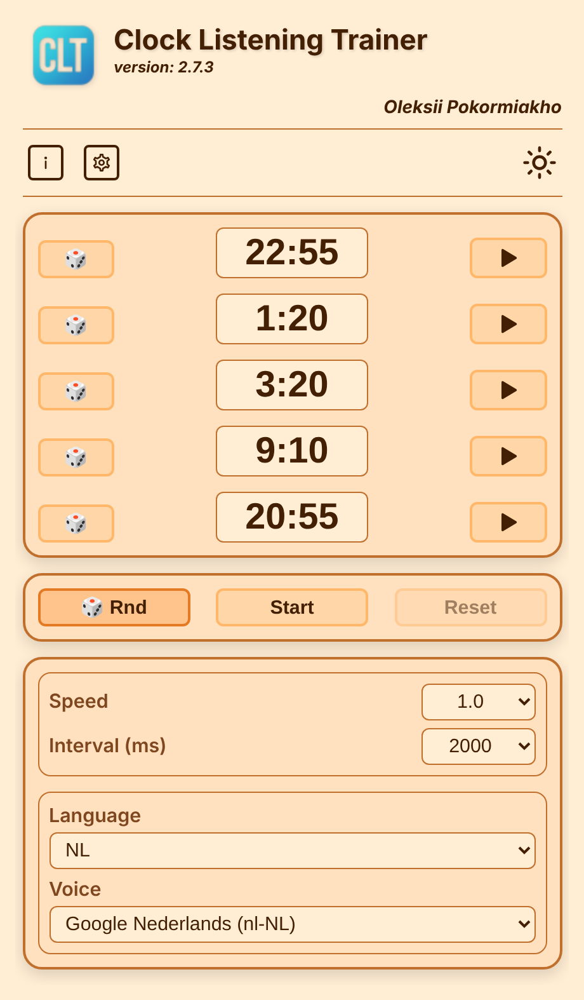
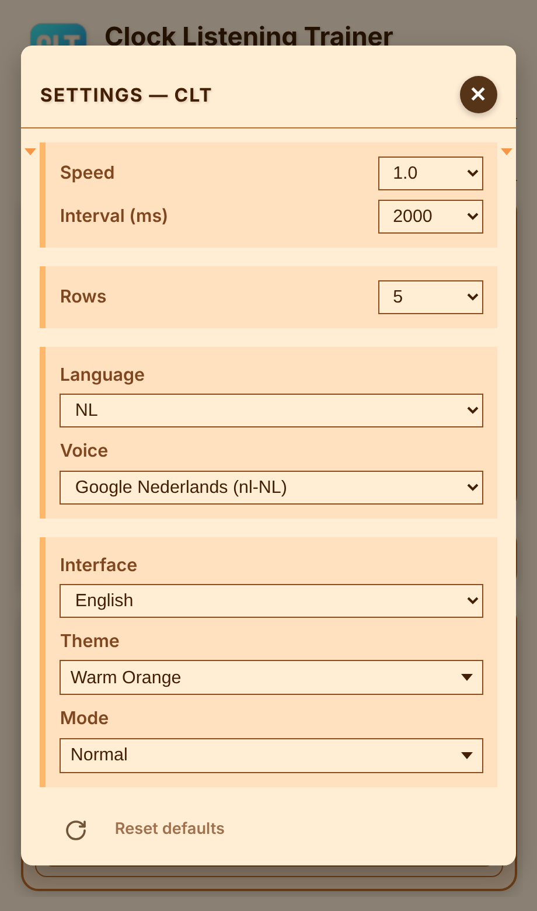

🌐 Verfügbare Sprachen:  
[العربية](README.ar.md) | [Čeština](README.cs.md) | [Deutsch](README.de.md) | [English](README.en.md) | [Español](README.es.md) | [Français](README.fr.md) | [Italiano](README.it.md) | [Nederlands](README.nl.md) | [Polski](README.pl.md) | [Português](README.pt.md) | [Русский](README.ru.md) | [Türkçe](README.tr.md) | [Українська](README.uk.md)

---

# CLT Clock Listening Trainer

Dies ist eine kompakte, einseitige Anwendung zum Erlernen der Uhrzeit in Fremdsprachen.  
Die App spricht Uhrzeiten in der gewählten Sprache aus und spielt eine ganze Liste von Uhrzeiten nacheinander ab. So schulen Sie Ihr Gehör dafür, wie die Zeit in verschiedenen Sprachen ausgedrückt wird.

## Funktionen

- Zeigt eine Liste zufälliger Uhrzeiten (jede Zeile lässt sich mit ihrer Würfel-Schaltfläche neu auswürfeln) und spricht jede in der gewählten Sprache aus.
- Spielt die ganze Liste nacheinander ab (Start, Pause, Zurücksetzen) und schult so das Ohr für die Art, wie Zeit ausgedrückt wird.
- Stelle Zeilenanzahl (1–15), Sprechgeschwindigkeit, Intervall zwischen den Zeiten sowie Sprache und Stimme ein.
- Uhrzeiten werden in zehn Sprachen in natürlicher Formulierung gesprochen (z. B. „Viertel nach drei“).
- Läuft auf Smartphone und Computer, in 13 Oberflächensprachen, mit 10 Farbthemen in vier Modi (normal, Abend, Nacht, Kontrast).

## Einstellungen

Das Einstellungsfenster enthält Geschwindigkeit und Intervall, Zeilenanzahl, Sprache und Stimme, Oberflächensprache, Thema und Modus sowie das Zurücksetzen auf Standardwerte.

## Erste Schritte

Öffne die App im Browser: https://oleksiypok.github.io/CLT/. Es muss nichts installiert werden, und deine Einstellungen werden im Browser gespeichert.

---

🌐 Verfügbare Sprachen:  
[العربية](README.ar.md) | [Čeština](README.cs.md) | [Deutsch](README.de.md) | [English](README.en.md) | [Español](README.es.md) | [Français](README.fr.md) | [Italiano](README.it.md) | [Nederlands](README.nl.md) | [Polski](README.pl.md) | [Português](README.pt.md) | [Русский](README.ru.md) | [Türkçe](README.tr.md) | [Українська](README.uk.md)
